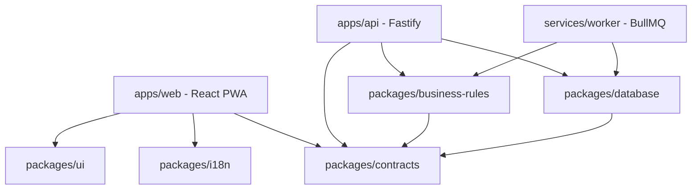
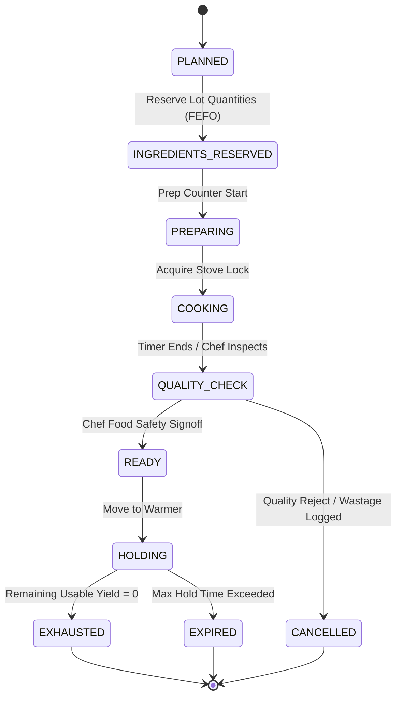
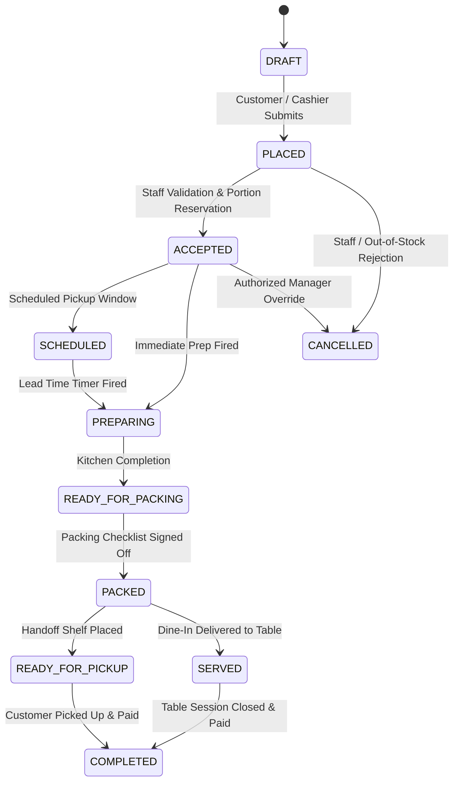
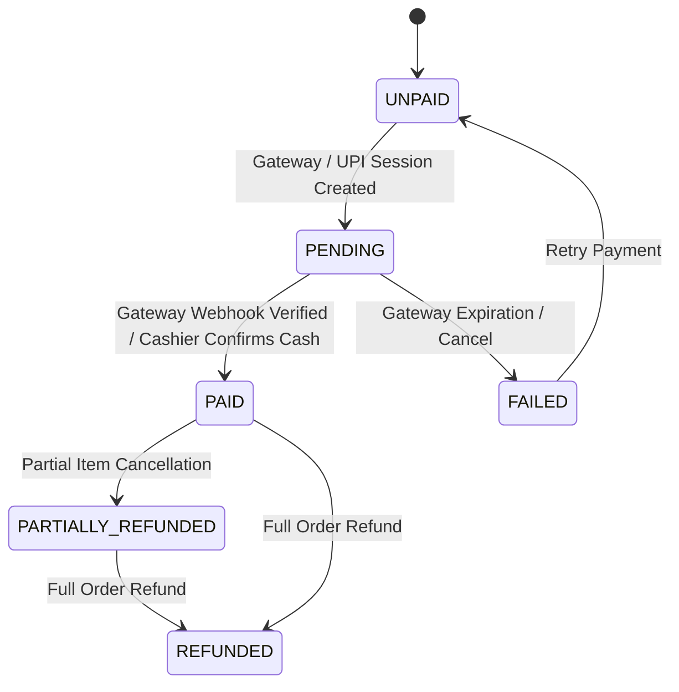

# PANTRYOS — SYSTEM ARCHITECTURE SPECIFICATION
**Version:** 1.0 | **Date:** 17 November 2026 | **Status:** Phase 0 Approved

---

## 1. Architectural Philosophy
PantryOS is architected as a **Modular Monolith** in TypeScript. This deliberate design pattern satisfies the operational reality of a small Karnataka food pantry:
1. **Low Operational Overhead:** No microservice orchestration, distributed tracing baggage, or inter-service network latency.
2. **Strict Transactional Invariants:** PostgreSQL provides atomic ACID transactions across inventory reservations, batch portion depletion, and order creation.
3. **Domain Boundary Isolation:** Clean modular packages with strict unidirectional dependency flow. Business logic resides in pure functional domain services, completely decoupled from React components and direct database queries.
4. **PWA First-Class Experience:** A responsive, installable Progressive Web App powering cashier desktop, chef tablets in the kitchen, and diner mobile smartphones via QR code.

---

## 2. Monorepo Structure & Workspaces
The repository uses `pnpm` workspaces:

```
pantry-os/
├── apps/
│   ├── web/                    # React 19 + Vite PWA (Admin, Cashier, Chef KDS, Customer QR)
│   └── api/                    # Fastify 5 REST API + WebSocket server
├── packages/
│   ├── contracts/              # Shared Zod schemas, DTOs, and API contract interfaces
│   ├── database/               # Drizzle ORM schema, migrations, connection pool, seed scripts
│   ├── business-rules/         # Pure decimal-safe calculation engines, state machines, policies
│   ├── ui/                     # Design system (Warm Pantry theme, Radix primitives, Tailwind)
│   ├── i18n/                   # English and Kannada localization dictionaries & helpers
│   └── config/                 # Shared TypeScript, ESLint, and Prettier configurations
├── services/
│   └── worker/                 # BullMQ async background jobs (timers, notifications, cleanup)
├── docs/                       # Complete engineering specifications & runbooks
├── scripts/                    # Dev environment, database reset, seeding, verification scripts
├── pnpm-workspace.yaml
└── package.json
```

---

## 3. Technology Stack & Verification Matrix

| Layer | Chosen Technology | Version Baseline | Justification / Notes |
| :--- | :--- | :--- | :--- |
| **Runtime** | Node.js | v22.12.0 (Active LTS) | Verified in environment; stable, LTS lifecycle. |
| **Package Manager**| pnpm | 12.21.0 | Fast, strict isolated dependencies via content-addressable store. |
| **Backend Framework**| Fastify | 5.x stable | High throughput, low overhead, native TypeScript support, OpenAPI generation. Fastify 6 alpha avoided. |
| **API Schema & Types**| Zod + `fastify-type-provider-zod` | 3.23+ | Single source of truth for runtime validation and static TypeScript inference. |
| **Database & ORM** | PostgreSQL + Drizzle ORM | Drizzle 0.38+ | Lightweight, type-safe SQL-like queries, explicit migrations. |
| **Dev DB Fallback** | PGlite (`@electric-sql/pglite`)| 0.2+ | WASM-powered real PostgreSQL engine running locally in Node when Docker/system psql is unavailable. |
| **Cache & Queues** | Redis + BullMQ | BullMQ 5.x | Server-authoritative step timers, delay queues, and event retries. |
| **Real-time Comms** | Fastify WebSocket (`@fastify/websocket`) | 10.x | Low-latency, branch-scoped order, batch, and kitchen status broadcasts. |
| **Frontend Framework**| React 19 + React Router | 19.x stable | Modern concurrent rendering, clean routing, zero legacy hooks. |
| **Build & PWA** | Vite + `vite-plugin-pwa` | Vite 6.x | Instant HMR, automated Service Worker generation, installable manifest. |
| **Styling & UI** | Tailwind CSS + Radix UI | Tailwind v3.4 / v4 stable | Warm Pantry design system (#FAF8F3 cream, #234B3A forest green, #D79B52 amber). |
| **Data Fetching** | TanStack Query (React Query) | v5.x | Automatic cache invalidation, polling fallback, optimistic mutations. |
| **Media Processing**| Sharp | 0.33+ | Server-side image optimization to WebP/AVIF, thumbnails, and security metadata stripping. |
| **Testing** | Vitest + Playwright | Latest stable | Unit and integration test runner for business rules; browser E2E tests. |

---

## 4. Domain Boundaries & Dependency Graph



### Module Responsibilities:
1. **`packages/contracts`**: Pure schemas (Zod). Zero runtime database or React dependencies. Defines request/response shapes for `/api/v1` routes and WebSocket event envelopes.
2. **`packages/business-rules`**: Pure domain calculations. Includes:
   - Decimal-safe currency arithmetic (`dinero.js` or standard scaled-integer math, 1 INR = 100 paise).
   - Decimal-safe weight/volume conversions (kg $\leftrightarrow$ g, L $\leftrightarrow$ ml).
   - Batch portion calculation from actual yield ($Usable\_Yield \div Portion\_Size$).
   - Finite state machines (Batch, Order, Payment, Equipment).
   - Stove exclusive locking algorithms.
   - Unified omnichannel availability check.
3. **`packages/database`**: Drizzle schema definitions, relations, index definitions, and database migrations.
4. **`packages/ui`**: Shared button, badge, modal, sheet, and card primitives utilizing the Warm Pantry color system.
5. **`packages/i18n`**: Kannada (ಕನ್ನಡ) and English dictionaries with typed translation keys.

---

## 5. Core Operational State Machines

### 5.1 Batch Lifecycle


### 5.2 Order Lifecycle


### 5.3 Payment Lifecycle (Strictly Decoupled from Fulfillment)


---

## 6. Real-Time WebSocket Architecture
- Fastify server listens on `/api/v1/ws`.
- Client connects with an authenticated session cookie or validated table token.
- Subscriptions are strictly branch-scoped (`branch:${branchId}`).
- Event Types:
  - `ORDER_STATUS_CHANGED`: Updates Cashier POS and Customer Mobile views.
  - `KITCHEN_TASK_CREATED` / `UPDATED`: Updates Chef KDS tickets and countdowns.
  - `EQUIPMENT_LOCK_STATE`: Prevents stove scheduling collisions.
  - `BATCH_PORTION_RESERVED` / `EXHAUSTED`: Dynamically toggles item availability on customer QR menus.
- **Heartbeat & Resiliency:** Server emits ping every 30s; client automatically reconnects with exponential backoff and fetches an authoritative snapshot (`GET /api/v1/sync/snapshot`) to reconcile missed events.

---

## 7. Storage & Media Abstraction
- **Development Mode:** Local disk storage under `apps/web/public/uploads` with static serve.
- **Production Mode:** S3-compatible object storage (Cloudflare R2, MinIO, or AWS S3) with signed URLs.
- **Processing:** Sharp pipeline resizes original images into three variants:
  1. `thumbnail` (120x120 webp) for cart items and ingredient lists.
  2. `card` (400x300 webp) for menu grid and POS tiles.
  3. `hero` (800x600 webp) for dish detail modal.
- Safe upload sanitization: strips EXIF metadata, checks magic byte headers, and generates collision-free UUID filenames.
