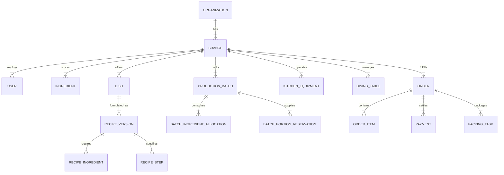

# PANTRYOS — DATABASE SCHEMA SPECIFICATION
**Version:** 1.0 | **Date:** 17 November 2026 | **Status:** Phase 0 Approved

---

## 1. Schema Design Principles
1. **Multi-Tenant Branch Isolation:** Every operational table carries `organization_id` and `branch_id` foreign keys with composite indexes.
2. **Numeric Precision:** All weights, volumes, and monetary amounts are stored as exact numeric/integer values to eliminate floating-point drift:
   - Currency: Scaled integer in paise (e.g., ₹65.00 = `6500` paise).
   - Weights: Grams (`numeric(12, 3)` or exact integer grams).
   - Volumes: Milliliters (`numeric(12, 3)` or exact integer ml).
3. **Audit Trail & Immutability:** Stock movements, batch history, payment attempts, and order status transitions are append-only ledgers.
4. **Timezone Standardization:** Canonical timestamps stored as `TIMESTAMPTZ` (UTC); frontend renders in `Asia/Kolkata` (IST, UTC+5:30).

---

## 2. Entity Domain Breakdown

---

## 3. Complete Entity Dictionary

### Domain 1: Organization & Identity
1. `organizations`: Root enterprise entity (name, slug, tax_id/GSTIN, logo_url).
2. `branches`: Physical locations (name, code, address, phone, business_hours, timezone, currency).
3. `users`: System accounts (email, password_hash via Argon2id, full_name, phone, active_status).
4. `roles`: Role definitions (`SUPER_ADMIN`, `BRANCH_MANAGER`, `CHEF`, `KITCHEN_ASSISTANT`, `CASHIER`, `PACKER`, `WAITER`, `CUSTOMER`).
5. `user_roles`: Many-to-many relationship linking users, roles, and branch scope.
6. `dining_tables`: Physical restaurant tables (table_number, qr_token, seating_capacity, status).
7. `table_sessions`: Active customer sessions bound to a table token (session_token, opened_at, closed_at, active_order_id).

### Domain 2: Inventory & Procurement
8. `units`: Measurement units (`g`, `kg`, `ml`, `l`, `pcs`, `pack`).
9. `unit_conversions`: Conversion matrix (e.g., $1 \text{ kg} = 1000 \text{ g}$).
10. `ingredient_categories`: Logical groups (Grains, Pulses, Vegetables, Spices, Oils, Packaging).
11. `ingredients`: Raw materials and packaging items (name_en, name_kn, category_id, base_unit_id, reorder_level, storage_location).
12. `suppliers`: Vendor registry (name, contact_person, phone, email, gstin, address).
13. `purchase_orders`: Inbound procurement orders (po_number, supplier_id, status: `DRAFT`, `ORDERED`, `RECEIVED`, `CANCELLED`).
14. `purchase_items`: Line items on purchase orders (po_id, ingredient_id, quantity, unit_cost_paise, total_cost_paise).
15. `stock_lots`: Distinct physical batches of inventory received (lot_number, ingredient_id, initial_quantity, current_quantity, unit_cost_paise, received_at, expires_at, status: `AVAILABLE`, `DEPLETED`, `EXPIRED`, `QUARANTINED`).
16. `stock_movements`: Immutable stock ledger (movement_type: `PURCHASE_RECEIPT`, `BATCH_RESERVATION`, `BATCH_CONSUMPTION`, `BATCH_RETURN`, `WASTAGE`, `ADJUSTMENT`, quantity, reference_id, actor_id, created_at).
17. `stock_adjustments`: Physical audit reconciliations with mandatory reason codes.

### Domain 3: Recipes & BOM
18. `recipes`: Abstract culinary entities (dish_id, name_en, name_kn, description_en, description_kn, preparation_policy: `READY_BATCH`, `FRESH_ORDER`, `FINISH_ON_DEMAND`).
19. `recipe_versions`: Immutable approved recipe formulas (recipe_id, version_number, status: `DRAFT`, `UNDER_REVIEW`, `APPROVED`, `ARCHIVED`, base_yield_quantity, yield_unit_id, approved_by_user_id, approved_at).
20. `recipe_ingredients`: Bill of Materials (recipe_version_id, ingredient_id, quantity, unit_id, is_sub_recipe, sub_recipe_id, waste_factor_pct).
21. `recipe_steps`: Sequential cooking guidance (recipe_version_id, step_order, title_en, title_kn, instruction_en, instruction_kn, duration_seconds, equipment_type_needed, media_url).
22. `allergens`: Allergen definitions (Gluten, Dairy, Peanuts, Mustard, etc.).
23. `recipe_allergens`: Association table between recipe versions and allergens.

### Domain 4: Menu & Dishes
24. `menu_categories`: Customer menu sections (Starters, Main Course, Rotis, Combos).
25. `dishes`: Customer-facing items (menu_category_id, name_en, name_kn, is_active, display_order, recipe_id).
26. `dish_variants`: Portion sizing and packaging options (dish_id, name_en, name_kn, portion_weight_grams, portion_volume_ml, price_paise, packaging_item_id).

### Domain 5: Kitchen & Equipment
27. `kitchen_stations`: Logical areas (Stove Station, Prep Counter, Tawa Station, Packing Pass).
28. `kitchen_equipment`: Physical equipment (name_en, station_id, equipment_type: `GAS_STOVE`, `TAWA`, `PREP_TABLE`, `VESSEL`, status: `AVAILABLE`, `OCCUPIED`, `MAINTENANCE`).
29. `cooking_tasks`: Active assignments on equipment (batch_id, equipment_id, chef_user_id, current_step_id, started_at, target_finish_at, actual_finish_at, status: `ASSIGNED`, `IN_PROGRESS`, `PAUSED`, `COMPLETED`, `ABORTED`).
30. `task_events`: Step acknowledgment logs and safety check records.

### Domain 6: Batch Production & Portions
31. `production_batches`: Physical cooking executions (batch_code, recipe_version_id, planned_yield, actual_usable_yield, yield_unit_id, status: `PLANNED`, `INGREDIENTS_RESERVED`, `PREPARING`, `COOKING`, `QUALITY_CHECK`, `READY`, `HOLDING`, `EXHAUSTED`, `EXPIRED`, `CANCELLED`, cooked_at, expires_at, quality_notes, signed_off_by_user_id).
32. `batch_ingredient_allocations`: Specific stock lots reserved and consumed by the batch.
33. `batch_portion_reservations`: Atomic allocation link between orders and production batches (batch_id, order_item_id, reserved_quantity, status: `RESERVED`, `DISPATCHED`, `RELEASED`).

### Domain 7: Orders & QR Channels
34. `orders`: Unified customer orders (order_number, channel: `WALK_IN_POS`, `QR_TABLE`, `PHONE_PICKUP`, `OWN_WEB`, `MOCK_ONDC`, `MOCK_ZOMATO`, `MOCK_SWIGGY`, status: `DRAFT`, `PLACED`, `ACCEPTED`, `SCHEDULED`, `PREPARING`, `READY_FOR_PACKING`, `PACKED`, `READY_FOR_PICKUP`, `SERVED`, `COMPLETED`, `CANCELLED`, table_session_id, customer_name, customer_phone, requested_pickup_at, promised_ready_at, subtotal_paise, tax_paise, packaging_fee_paise, total_paise).
35. `order_items`: Line items (order_id, dish_variant_id, quantity, unit_price_paise, subtotal_paise, special_instructions, status: `PENDING`, `PREPARING`, `READY`, `PACKED`, `SERVED`).
36. `order_events`: Immutable audit trail of state transitions with timestamp and actor.

### Domain 8: Packing & Handoff
37. `packing_tasks`: Kitchen pass parcel checklist (order_id, packer_user_id, status: `PENDING`, `IN_PROGRESS`, `PACKED`, `HANDED_OFF`, parcel_count, label_printed, packed_at).

### Domain 9: Payments & Cash Sessions
38. `payments`: Payment records (order_id, amount_paise, method: `CASH`, `UPI_QR`, `CARD`, `ONLINE_GATEWAY`, status: `UNPAID`, `PENDING`, `PAID`, `REFUNDED`, `FAILED`, transaction_ref, verified_at, verified_by_user_id).
39. `cash_sessions`: Register cash drawer shifts (cashier_user_id, opening_cash_paise, opened_at, closing_cash_paise, counted_cash_paise, variance_paise, closed_at, notes).

### Domain 10: Integrations & Media
40. `integration_providers`: Registry (`ONDC_RET11`, `ZOMATO_MOCK`, `SWIGGY_MOCK`).
41. `integration_events`: Inbound webhooks, payloads, deduplication keys, and processing status.
42. `media_assets`: Uploaded and seeded images (filename, file_path, mime_type, file_size_bytes, alt_text_en, alt_text_kn, dimensions, created_at).
