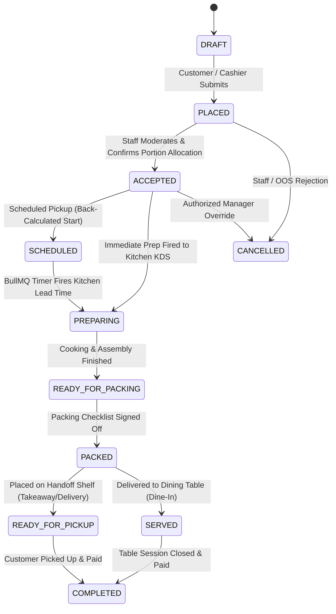

# PANTRYOS — ORDER LIFECYCLE & CAPACITY SCHEDULING SPECIFICATION
**Version:** 1.0 | **Date:** 17 November 2026 | **Status:** Phase 0 Approved

---

## 1. Omnichannel Order Model
PantryOS ingests customer orders from five distinct origin channels:
1. `WALK_IN_POS`: Fast counter order punched by the cashier.
2. `QR_TABLE`: Self-service mobile PWA order placed by diners at a physical table.
3. `PHONE_PICKUP`: Scheduled or immediate takeaway phoned into the cashier.
4. `OWN_WEB`: Consumer pre-order placed via the pantry's branded web portal.
5. `MOCK_EXTERNAL`: Standardized external order from ONDC RET11, Swiggy, or Zomato adapters.

Every channel normalizes into the authoritative `orders` entity with source metadata.

---

## 2. Order Fulfillment State Machine

---

## 3. Capacity-Aware Back-Scheduling Algorithm
When an order specifies a requested pickup time (e.g. 13:30 for 3 parcels):
1. **Target Ready Time ($T_{ready}$):** 13:25 (5-minute safety buffer before pickup).
2. **Packing Duration ($D_{pack}$):** Calculated based on parcel count (e.g., 5 mins).
   - $T_{pack\_start} = T_{ready} - D_{pack} = 13:20$.
3. **Cooking / Finishing Duration ($D_{cook}$):**
   - For `READY_BATCH` dishes (Bassaru, Bisi Bele Bath): Heated ladle allocation + garnish = 5 mins.
   - For `FRESH_ORDER` dishes (Akki Rotti): Tawa roasting time = 12 mins.
4. **Target Fire Time ($T_{fire}$):**
   - $T_{fire} = T_{pack\_start} - D_{cook} = 13:08$.
5. **Equipment Collision Check:**
   - The scheduling engine inspects existing active stove/tawa bookings between 13:08 and 13:20.
   - If Tawa 1 is booked until 13:15, the system prompts the cashier: *"Earliest feasible pickup time is 13:40 due to tawa load."* No impossible promises are silently accepted.
